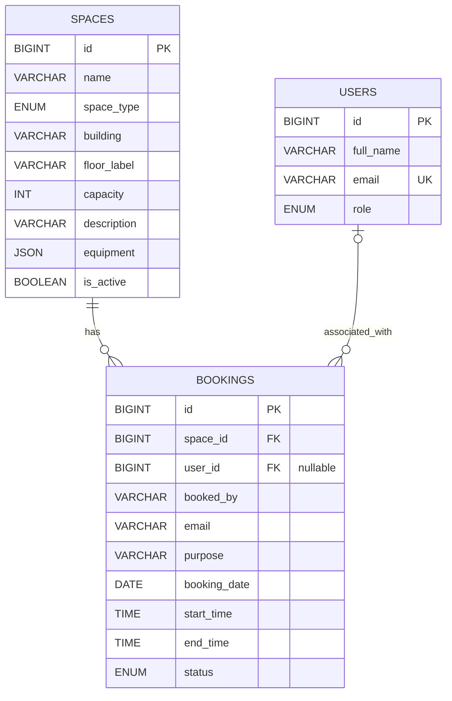

# Entity-Relationship Model

**Relationships:** one space can have many bookings; each booking belongs to one space. A user can optionally be linked to many bookings; demo bookings store name/email directly and leave `user_id` null. Active bookings for the same space cannot overlap on the same date. Adjacent periods (09:00–10:00 and 10:00–11:00) are allowed.
